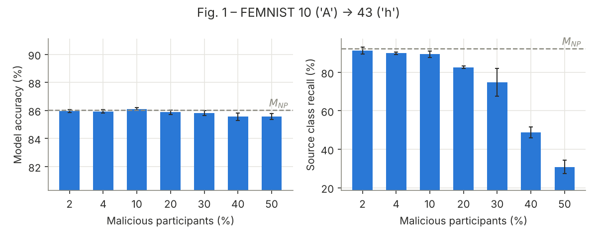
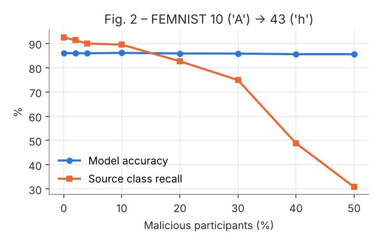

# Label flipping on FEMNIST: `A` → `h` vs. non-poisoned baseline

Second pair for the replication of Sec. 3.2 of Tolpegin et al. (ESORICS 2020) on LEAF FEMNIST
(62 classes). The setup is identical to the `O` → `0` run (see `attack_vs_baseline.md`):
N = 50 participants (IID), k = 5 per round, R = 200 rounds, FedAvg, the paper's
Fashion-MNIST CNN with 62 outputs. Malicious participants relabel every `A` in their local
data as `h` and otherwise train honestly. They take part in all 200 rounds.

**Pair `A` (10) → `h` (43).** This is the "infrequent" pair: the clean model sends only
1.6 `A` test images to `h` on average (m_cnt), against 72.3 for `O` → `0`. The two letters
do not look alike, so the model has no natural lean toward the attacker's target.

**Runs.** The baseline M_NP is the same 10 runs as for `O` → `0` (reused, not re-run). Each
attack level has 3 runs (seeds 3000–3002), except m = 50%, which has 2 because the third was
cut off by a time limit. The paper used 10 repetitions per level.

## Results (final global model, round 200)

| Malicious m | Global accuracy | `A` recall | Loss in `A` recall vs. M_NP | `A` images labeled `h` | `h` recall |
|---|---|---|---|---|---|
| 0% (M_NP) | 86.04 ± 0.09 | 92.47 ± 1.76 | — | 1.6 | 85.40 |
| 2% | 85.96 ± 0.12 | 91.32 ± 1.71 | 1.14 (noise) | 1.3 | 85.82 |
| 4% | 85.94 ± 0.13 | 89.95 ± 0.65 | 2.51 (noise) | 2.0 | 85.82 |
| 10% | 86.11 ± 0.10 | 89.50 ± 1.71 | 2.97 (borderline) | 2.0 | 86.21 |
| 20% | 85.87 ± 0.18 | 82.65 ± 0.65 | 9.82 | 6.0 | 86.59 |
| 30% | 85.83 ± 0.18 | 74.89 ± 7.28 | 17.58 | 12.7 | 86.21 |
| 40% | 85.57 ± 0.27 | 48.86 ± 2.81 | 43.61 | 29.3 | 86.59 |
| 50% | 85.57 ± 0.20 | 30.82 ± 3.42 | 61.64 | 42.5 | 86.78 |

Mean ± std over runs. `A` has only 73 test images, so one image is 1.37 recall points.




## Findings, in the paper's framing

1. **The attack works even though the pair is not confusable.** At m = 50%, `A` recall falls
   from 92% to 31%, and 42 of the 73 `A` test images are labeled `h`, a letter the clean
   model almost never confuses with `A`. Global accuracy drops by only 0.5 points
   (86.0 → 85.6), and from 2% to 30% malicious it stays within 0.2 points of the baseline.
   The attack is even harder to see in global accuracy than `O` → `0`, because `A` is only
   0.9% of the test set.
2. **The damage grows with m, slowly at first and then fast.** Below 10% the change in `A`
   recall is one or two images, inside the baseline's run-to-run noise (std 1.8). At 20% the
   loss is 10 points, at 30% it is 18, at 40% it is 44, and at 50% it is 62, the same
   disproportionate growth the paper reports.
3. **The damage stays on the attacked class (Table 3).** At m = 10%, `A` recall falls by
   3.0 points, `h` recall rises by 0.8, and the other 60 classes change by 1.4 points on
   average (absolute), which is the baseline's own noise (2.4). Unlike `O` → `0`, the target
   class barely gains even at 50% (+1.4): the flipped `A` images become *wrong* `h`
   predictions, but no real `h` images were being lost to `A` in the first place, so there
   is nothing for `h` to win back.
4. **Attacked runs are unstable over rounds.** Over the last 50 rounds, `A` recall varies
   with a std of 0.9 points in clean runs, 4.8 at m = 10%, and 13–19 at m = 30–50%. The
   value at round 200 depends on whether attackers were in the final round. At m = 30%, the
   two runs with an attacker in round 200 end at 70.5% `A` recall, the one without at 83.6%
   (few runs, so only indicative).

## Side by side with `O` → `0`

| | `O` → `0` | `A` → `h` |
|---|---|---|
| Pair type | frequent, visually confusable | infrequent, not confusable |
| m_cnt in clean model | 72.3 | 1.6 |
| Source test images (share of test set) | 299 (3.6%) | 73 (0.9%) |
| Source recall, clean | 75.2 | 92.5 |
| Loss in source recall at m = 10 / 20 / 30 / 40 / 50% | 6.4 / 7.4 / 17.2 / 42.8 / 68.0 | 3.0 / 9.8 / 17.6 / 43.6 / 61.6 |
| Source recall left at 50% (relative to clean) | 10% | 33% |
| Target recall change at 50% | +14.6 | +1.4 |
| Global accuracy drop at 50% | 1.9 | 0.5 |
| Other classes, mean abs change at 10% | 1.4 | 1.4 |
| Round-to-round std of source recall, clean → m = 40% | 2.7 → 22.7 | 0.9 → 18.5 |

**What this shows**

* **How confusable the pair is barely changes how much the attack hurts.** From 20% to 40%
  malicious, the absolute loss in source recall is almost the same for both pairs (within
  2.5 points), although m_cnt differs by a factor of 45. This matches the paper's
  observation that the most damaging pairs are not always the ones the clean model already
  confuses (its strongest CIFAR-10 result is the rare `airplane` → `bird` pair), and that
  m_cnt does not predict attack effectiveness.
* **Confusability matters at the edges.** At 10% the confusable pair loses about twice as
  much (6.4 vs 3.0), and at 50% it is almost fully taken over (7% recall left vs 31%). When
  the model already leans toward the target, a small push goes further, and a majority push
  finishes the job. For a non-confusable pair, honest updates still pull `A` back toward
  its real features even at 50%.
* **The target gains only when it was losing images to the source.** `0` recall rises by
  14.6 points under `O` → `0` because real `0` images that the clean model labeled `O` now go
  to `0`. `h` has no such images, so its recall stays flat. A defender looking for a class
  whose recall *rises* would only catch the confusable kind of attack.
* **A rarer source class hides the attack better.** Both attacks are invisible in global
  accuracy up to 30%, but at 50% `A` → `h` costs 0.5 points against 1.9 for `O` → `0`,
  because `A` has a quarter as many test images. This is the paper's remark about datasets
  with many classes, made sharper by FEMNIST's class imbalance.

## Differences from the paper

* **A higher threshold than the paper reports.** As for `O` → `0`, 1–2 malicious participants
  out of 50 have no measurable effect, and at 10% the effect is borderline (about 2 images).
  Each participant holds only about 1/50 of the `A` training images, and each round
  averages 5 models, so one poisoned update is outweighed by honest ones.
* **Very small source class.** With 73 test images, recall moves in steps of 1.37 points,
  so small effects are hard to separate from noise. The paper's source classes have 1,000
  test images each.
* **Fewer repetitions.** 3 repetitions instead of 10 (2 at m = 50%). The spread is up to
  7 points (m = 30%), so the trend is clear but individual values are less precise.

## Reproduce

```bash
python3 label_flipping_attack.py --source 10 --target 43 --malicious-pct 2 4 10 20 30 40 50 --num-exp 3 --jobs 4
ln -sfn "$PWD/results/label_flipping/0_to_0/m0" results/label_flipping/10_to_43/m0
python3 analyze.py feasibility results/label_flipping/10_to_43 --out analysis
```

The run outputs are committed under `results/label_flipping/10_to_43/` (without debug logs)
and `analysis/`. Finished runs are skipped, so the first line re-runs only the missing third
m = 50% repetition. On Windows without symlinks, copy the baseline instead:
`xcopy /E /I results\label_flipping\0_to_0\m0 results\label_flipping\10_to_43\m0`.
