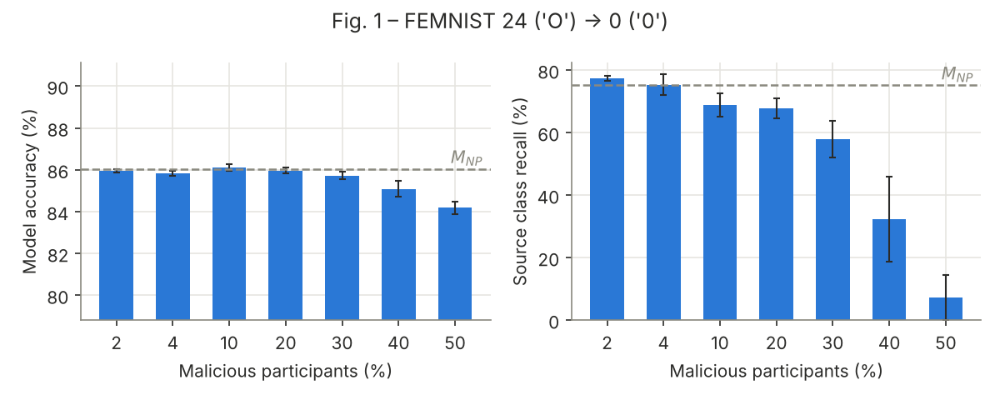
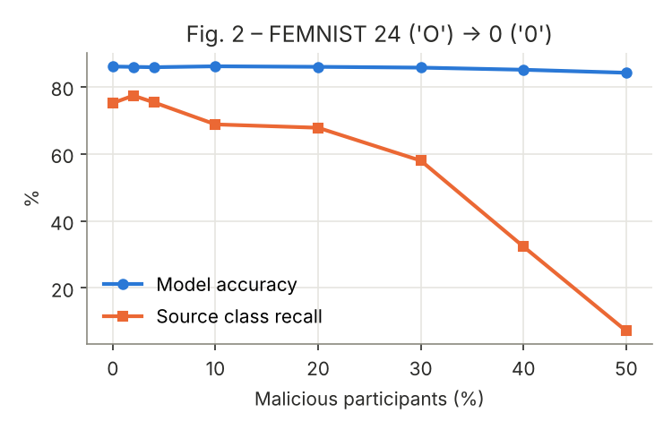

# Label flipping on FEMNIST: attack vs. non-poisoned baseline

Replication of Sec. 3.2 of Tolpegin et al. (ESORICS 2020) on LEAF FEMNIST (62 classes).
Setup as in the paper: N = 50 participants (IID), k = 5 per round, R = 200 rounds, FedAvg,
the paper's Fashion-MNIST CNN with 62 outputs. Malicious participants relabel every `O`
in their local data as `0` and otherwise train honestly. They take part in all 200 rounds.

**Pair `O` (24) → `0` (0).** This is the "frequent" pair: the clean model already sends
72.3 `O` test images to `0` on average (m_cnt), its second-largest confusion.

**Runs.** The baseline M_NP has 10 runs. Each attack level has 3 runs (seeds 3000–3002),
except m = 50%, which has 2 because the third was cut off by a time limit.
The paper used 10 repetitions per level.

## Results (final global model, round 200)

| Malicious m | Global accuracy | `O` recall | Loss in `O` recall vs. M_NP | `O` images labeled `0` |
|---|---|---|---|---|
| 0% (M_NP) | 86.04 ± 0.09 | 75.15 ± 2.73 | — | 72.3 |
| 2% | 85.94 ± 0.09 | 77.37 ± 0.83 | −2.22 (noise) | 65.7 |
| 4% | 85.84 ± 0.11 | 75.36 ± 3.26 | −0.21 (noise) | 71.7 |
| 10% | 86.12 ± 0.15 | 68.78 ± 3.71 | 6.37 | 91.3 |
| 20% | 85.95 ± 0.14 | 67.78 ± 3.15 | 7.37 | 94.3 |
| 30% | 85.72 ± 0.18 | 57.97 ± 5.88 | 17.18 | 123.3 |
| 40% | 85.08 ± 0.37 | 32.33 ± 13.56 | 42.82 | 200.7 |
| 50% | 84.19 ± 0.29 | 7.19 ± 7.19 | 67.96 | 275.5 |

Mean ± std over runs. `O` has 299 test images.




## Findings, in the paper's framing

1. **The attack is targeted and hard to notice.** At m = 50%, `O` recall falls from 75% to
   7%, so the model labels almost every `O` as `0`. Global accuracy drops by only 1.9 points
   (86.0 → 84.2). From 2% to 30% malicious, global accuracy stays within 0.3 points of the
   baseline. A server watching global accuracy would see nothing unusual.
2. **The damage grows with m, slowly at first and then fast.** Below 10% the change in
   `O` recall is inside the baseline's run-to-run noise (std 2.7). From 10–20% the loss is
   about 6–7 points, at 30% it is 17, at 40% it is 43, and at 50% it is 68. The paper reports
   the same pattern, a disproportionately large loss as m grows, for CIFAR-10 and
   Fashion-MNIST.
3. **The damage stays on the attacked pair (Table 3).** At m = 10%, `O` recall falls by
   6.4 points and `0` recall rises by 5.6, because `0` absorbs the flipped images. The other
   60 classes change by 1.4 points on average, which is the baseline's own noise (2.3).

## Differences from the paper

* **A higher threshold than the paper reports.** On FEMNIST, 1–2 malicious participants
  out of 50 have no measurable effect. One likely reason is that each participant holds only
  about 1/50 of the `O` training images. Each round averages 5 models, so one poisoned update
  is outweighed by honest updates that keep the correct label.
* **Confusable pair.** `O` and `0` already look alike, so the poisoned label pushes the
  model in a direction it was partly leaning anyway.
* **Fewer repetitions.** With 3 repetitions instead of 10, the spread is wide at 40–50%
  (std up to 14 points). The trend is clear, but individual values are less precise than in
  the paper.

## Reproduce

```bash
python3 label_flipping_attack.py --source 24 --target 0 --malicious-pct 2 4 10 20 30 40 50 --num-exp 3 --jobs 4
ln -sfn "$PWD/results/label_flipping/0_to_0/m0" results/label_flipping/24_to_0/m0
python3 analyze.py feasibility results/label_flipping/24_to_0 --out analysis
```

To match the paper's 10 repetitions, re-run the first line with `--num-exp 10`. Finished runs are skipped.
