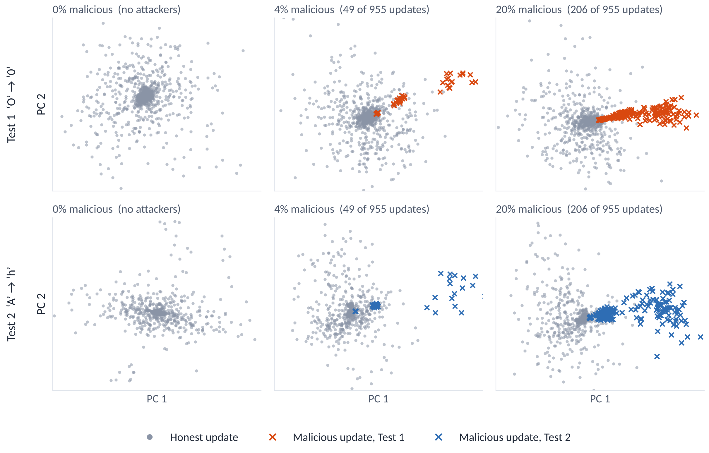
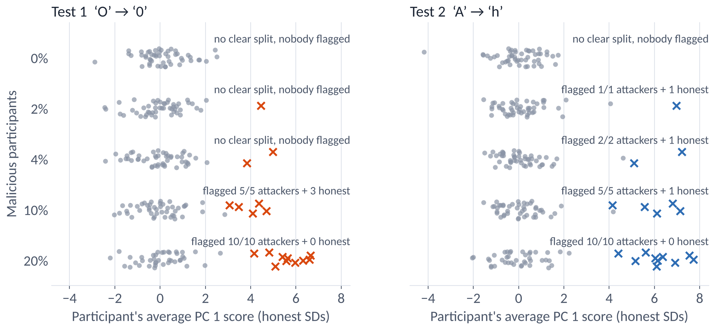

# Defending against label flipping: Algorithm 1 on FEMNIST

This is the paper's Sec. 4 defense (Algorithm 1) run on our two attacks, `O` → `0` (Test 1) and
`A` → `h` (Test 2). Setup is as in the attack runs: N = 50, k = 5, R = 200, IID, FedAvg.
Each level was re-run once (seed 3000) with the participants' updates recorded. The re-runs
end with exactly the same final accuracy and recall as the original seed-3000 runs, so
recording did not change training.

## How the defense works

A label flip changes only how a malicious participant treats **one class**. So the server
does not need to look at the whole model, only at the part that decides that class:

1. **Take the source-class row.** For every update in rounds 10–200 (955 updates), compute
   θ_Δ = local model − global model and keep only the 1,568 weights of the last layer that
   feed the source class's output (`O`, or `A`).
2. **Compress.** Standardize the 955 × 1,568 matrix and project it onto 2 principal
   components. Algorithm 1 stops here, with a plot that a person inspects.
3. **Average per participant (our rule).** Each participant is picked about 19 times. We
   average its PC 1 score over those updates.
4. **Flag the odd group (our rule).** Split the 50 averages into two groups with 2-means. If
   the split is clear (silhouette ≥ 0.65), the smaller group is flagged and can be excluded
   from aggregation. Otherwise nobody is flagged.

The paper gives only the plot, so steps 3–4 are our own way to turn it into an automatic
decision and into numbers.

**Why the attackers should stand out.** On an `O` image, an honest participant's gradient
raises the `O` output, so it pulls the `O` row *toward* the image's features. A malicious
participant has the same images labeled `0`, so its gradient lowers the `O` output and pushes
the row *away*. The two kinds of update point in opposite directions on exactly these
weights. The averaged honest and malicious updates have a cosine of −0.6 to −0.97 in our
runs. Every other row of the model is trained the same way by both kinds of participant, which
is why looking only at the source row helps.



With no attackers (left), the updates form one round cloud. With attackers, the malicious
updates (crosses) move off along PC 1.

## Results



Participant-level detection, rounds 10–200 (one seed per level):

| Malicious | Test 1 `O` → `0` | Test 2 `A` → `h` |
|---|---|---|
| 0% | nobody flagged | nobody flagged |
| 2% (1 attacker) | not flagged (split not clear) | 1/1 caught, 1 honest flagged |
| 4% (2) | not flagged (split not clear) | 2/2 caught, 1 honest flagged |
| 10% (5) | 5/5 caught, 3 honest flagged | 5/5 caught, 1 honest flagged |
| 20% (10) | 10/10 caught, 0 honest flagged | 10/10 caught, 0 honest flagged |

Using only rounds 10–50, so that the server could act early, gives the same picture:

* Test 1: not flagged at 2–4%; 5/5 (+2 honest) at 10%; 10/10 (+1 honest) at 20%.
* Test 2: 1/1, 2/2 (+1), 5/5, 10/10 (+1).

**Separation without any rule.** Ranking participants by their average PC 1 score puts
every attacker above every honest participant in 7 of the 8 attacked runs. In the eighth
(Test 2, 10%), one honest participant outranks one attacker. At the level of single updates,
PC 1 still separates the groups well, with an AUC of 0.93–0.98 in both tests.

**What did not work.** First we tried running 2-means directly on the 955 points of the 2-D
plot. That failed:

* It flagged 147 updates in the clean `O` run.
* It missed most `A` attackers at 4–20%.

The reason is gradient drift. Early updates are 6–12 times larger than late ones (the
learning rate decays and the model converges), and that size difference dominates the plot.
So the plain 2-means rule split early from late rounds, not honest from malicious. Averaging
each participant over its rounds removes the drift, because every participant is picked
across the whole training run. Dividing each update by its round's median size made things
worse, because it inflated small late-round outliers.

## Why it works better for `A` than for `O`

We expected the opposite. Each participant has only about 13 `A` training images against
about 53 `O` images, so we thought the `A` signal would be weaker. The data says that what
matters is **how loud the honest background is**, not how strong the attacker's signal is:

| Source-row update, rounds 10–200 | `O` (Test 1) | `A` (Test 2) |
|---|---|---|
| Size of an honest update (mean L2 norm) | 0.084–0.095 | 0.038–0.047 |
| Attacker update ÷ honest update | 1.1–1.7× | 1.6–3.0× |
| Gap between groups on PC 1 (honest SDs) | 2.2–2.6 | 2.8–4.3 |
| Clean-model recall of the source class | 75% | 92% |

* **`A` is already learned.** The clean model gets 92% of `A`s right and almost never
  confuses `A` with `h`. On a well-learned class the loss is small, so honest updates barely
  move the `A` row. An attacker who labels confident `A`s as `h` has a large loss, so it
  produces a large update in the opposite direction. A loud signal against a quiet
  background stands out, even from a single attacker.
* **`O` is still being argued over.** The clean model confuses `O` and `0` on about a
  quarter of `O` images. Honest participants are always correcting the `O` row, so their
  updates are twice as large and much more varied. An attacker's update is only slightly
  larger and sits nearer the honest cloud. With 1–2 attackers, the honest spread is wide
  enough that the split does not look clear (silhouette 0.51–0.54, vs 0.57 for the clean
  run), and the rule declines to act. The attackers are still the most extreme participants
  (2% and 4% in the figure), but not by a margin we can tell apart from chance.
* **The look-alike pair works against the defender twice.** In the attack experiments, the
  confusable pair took more damage at 10% and 50%. Here it is also harder to detect at low
  attacker shares.

## Would it fix the attack?

* **Damaging levels are covered.** In the attack experiments, 2–4% attackers had no
  measurable effect on either pair (`O` recall −2.2 and −0.2 pts, `A` −1.1 and −2.5, inside
  the noise). Every level that did measurable damage (10% and up) had all of its attackers
  flagged in both tests. If the flagged participants are left out of FedAvg, no attacker is
  left, and recall should return to its clean level (75% `O`, 92% `A`).
* **Excluding honest participants is cheap.** At most 3 honest participants (6% of the data)
  were flagged in any run. With IID data the remaining 47 hold the same distribution, so
  their loss should cost much less than the 0.09-point noise in accuracy.
* **This is an estimate, not a measurement.** We have not re-trained with the flagged
  participants removed. Under the early window (rounds 10–50), attackers still act for the
  first 50 rounds. The round-by-round curves show that recall recovers within a few clean
  rounds, so this should matter little.

## Caveats

* **One seed per level** (the attack runs used 3), so the counts in the tables are single
  observations.
* **The decision rule and its threshold are ours, set after seeing the clean runs.**
  * The clean runs give silhouettes of 0.54–0.59 and the attacked `A` runs 0.79–0.83, so for
    Test 2 almost any cutoff in between gives the same result.
  * For Test 1, 10% sits at 0.69–0.72 and 2–4% at 0.51–0.56, overlapping the clean runs. The
    `O` result at low attacker shares therefore depends on the cutoff.
* **The server must know which class is attacked.** In practice it would repeat this for
  each of the 62 output rows. We have not measured the false-alarm rate across 62 tests.
  It will be higher than for one.
* **The attackers here are naive.** They flip every source label and otherwise train
  normally. An attacker who scales down its update or flips only some labels would be harder
  to see. That is not tested.
* **The data is IID.** With per-writer (non-IID) data, honest participants would differ more
  from each other, which widens the honest cloud. As the `O` case shows, a wider honest cloud
  is exactly what makes attackers harder to separate.

## Reproduce

```bash
python3 label_flipping_attack.py --source 24 --target 0  --malicious-pct 0 2 4 10 20 --num-exp 1 --jobs 4 --record-deltas --output-dir results_defense
python3 label_flipping_attack.py --source 10 --target 43 --malicious-pct 0 2 4 10 20 --num-exp 1 --jobs 4 --record-deltas --output-dir results_defense
python3 defense_eval.py results_defense/label_flipping/24_to_0  --source 24 --out analysis
python3 defense_eval.py results_defense/label_flipping/10_to_43 --source 10 --out analysis
python3 writeup/deck_charts/charts_defense.py
```

The full numbers, including the update-level rule that was rejected, are in
`analysis/defense_24_to_0.json` and `analysis/defense_10_to_43.json`.
